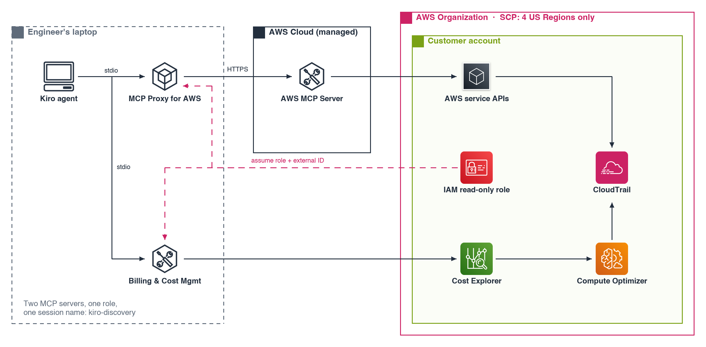

# Read-only AWS discovery and cost savings with Kiro and MCP

Companion code for the post **The Easy Button for AWS Account Details and Cost Savings** on Medium.

An AI agent (Kiro) maps an AWS account and builds a ranked savings report, using two MCP servers under one read-only IAM role, and CloudTrail proves afterward that nothing was written.



- **AWS MCP Server** (managed, remote): inventory through `aws___run_script`, reached through the MCP Proxy for AWS with SigV4.
- **AWS Billing and Cost Management MCP server** (open source, local): Cost Explorer, Cost Optimization Hub, Compute Optimizer, Savings Plans, Budgets, and Pricing.

## What's here

| Path | What it is |
|---|---|
| `terraform/` | The read-only role: `ViewOnlyAccess`, a scoped cost policy, five metadata reads, and an explicit deny on data-plane reads |
| `.kiro/settings/mcp.json` | Both MCP servers, pinned versions, no auto-approve |
| `.kiro/steering/discovery.md` | The rules the agent follows |
| `prompts.md` | The prompts from the post, in order |
| `scripts/verify-readonly.sh` | CloudTrail check: succeeded writes, denied writes, denied reads |

## Versions

| Component | Version |
|---|---|
| Terraform | >= 1.6 (tested with 1.13.4) |
| hashicorp/aws provider | ~> 6.0 |
| AWS CLI | >= 2.32.0 |
| mcp-proxy-for-aws-cli | 1.7.0 |
| awslabs.billing-cost-management-mcp-server | 0.0.39 |

## Before you start

- **Don't use the root user.** Root can't assume a role and can't be limited by policy. Deploy with an IAM user or IAM Identity Center admin profile.
- **Opt in a day ahead, as an admin.** Cost Optimization Hub imports its rightsizing and idle findings from Compute Optimizer, so you need both, and each can take up to 24 hours to show recommendations. Opting in is a write, so the read-only role can't do it.
  ```bash
  aws cost-optimization-hub update-enrollment-status --status Active --region us-east-1 --profile <admin-profile>
  aws compute-optimizer update-enrollment-status --status Active --region us-east-1 --profile <admin-profile>
  ```
- **Don't pass `--read-only` to the MCP proxy.** It hides `aws___run_script`, the only tool that can see your account. The role is what keeps it read-only.

## Deploy

```bash
cd terraform
cp terraform.tfvars.example terraform.tfvars   # set trusted_principal_arns (and external_id for a customer account)
export AWS_PROFILE=<admin-profile>
terraform init
terraform plan -out tfplan                     # expect: one role, one attachment, two inline policies
terraform apply tfplan
terraform output -raw aws_config_profile       # paste into ~/.aws/config, then set source_profile
aws sts get-caller-identity --profile mcp-discovery
```

For a customer account, their admin deploys this in their account with your principal in `trusted_principal_arns` and an agreed `external_id`. Keep a separate copy of this folder (and its state) per account.

## Run

1. Open **this folder** (the one containing `.kiro/`) in Kiro, trust the workspace, then quit Kiro completely and reopen it. MCP servers in an untrusted workspace never start.
2. Leave Autopilot off so every tool call and shell command needs your approval.
3. Follow [prompts.md](prompts.md). Reports land in `reports/`, which is gitignored.

## Verify it stayed read-only

Run with an admin profile, a few minutes after the session ends, for every Region the agent touched:

```bash
AWS_PROFILE=<admin-profile> scripts/verify-readonly.sh 24 kiro-discovery us-east-1 us-east-2 us-west-1 us-west-2
```

The line that matters is `writes_succeeded=0`. The AWS MCP Server logs each of its own tool calls as a non-read-only `aws-mcp.amazonaws.com` event; the script counts those separately so they don't look like writes.

## Cost

- IAM role and AWS MCP Server: no charge.
- Cost Explorer API: about $0.01 per request.
- Kiro: about 8 credits for the runs in the post.

## Cleanup

```bash
cd terraform && terraform destroy
```

Then remove the `[profile mcp-discovery]` block from `~/.aws/config`.
